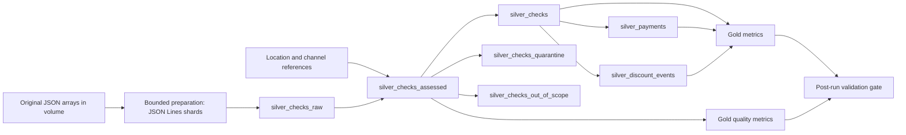

# Applebee's: Phase 2 pipeline deliverable

**Business objective:** produce trustworthy check, payment and discount tables so
operations can prioritize unusual activity for review. An anomaly is not proof of fraud.

**Current evidence:** an independent audit reread all **115 JSON files**, totaling
**2,142,846 checks, 127 locations and 115 days**, April 28 through August 20, 2026.
It reproduced **268,590 discounted checks**, **3,856 empty payment lists** and the
original tip-sign counts. A user-supplied screenshot confirms a successful dry run.
The first data-processing update **failed in Photon JSON scanning with an out-of-memory error**.
A bounded JSONL preparation task is now implemented and locally tested; its Databricks
run and a successful pipeline update remain pending. Local tests are not a successful Spark run.

## Exact repository hierarchy

```text
sun-holdings-applebees-fraud-detection/
├── README.md
├── .gitignore
├── .gitattributes
├── databricks.yml
├── resources/
│   ├── jobs/
│   │   └── daily_orchestration_job.yml
│   └── pipelines/
│       └── lakeflow_pipeline.yml
└── src/
    └── transformations/
        ├── silver/
        │   ├── mv_checks_cleaned.py
        │   ├── prepare_checks_jsonl.ipynb
        │   └── prepare_checks_jsonl_source.py
        └── gold/
            ├── mv_executive_kpis.sql
            ├── mv_quality_metrics.sql
            ├── validate_pipeline.ipynb
            ├── validate_pipeline_source.py
            ├── demo_queries.sql
            ├── RUNBOOK_ES.md
            ├── DATA_CONTRACT.md
            ├── RUBRIC_EVIDENCE.md
            ├── PRESENTATION_SCRIPT_EN.md
            ├── test_pipeline_contracts.py
            ├── verify_sources.py
            ├── source_audit.json
            └── historical_*                Retained Week 4 documentation and evidence
```

Only the four requested leaf directories are used. File names describe checks and
discounts rather than the illustrative orders/customers in the assignment. Root
files provide the bundle entry point and navigation. Supporting documentation,
notebooks and reports are colocated with their processing layer. Historical paths
are recorded in [migration_map.json](src/transformations/gold/migration_map.json).
The prior repository remains recoverable in Git history.

## Architecture and grain



| Dataset | Grain and purpose |
|---|---|
| `silver_checks_raw` | One typed source record, with original file path and corruption indicator |
| `silver_locations`, `silver_channels` | One row per reference ID; missing or duplicate reference IDs fail the update |
| `silver_checks_assessed` | Every source record, composite-key multiplicity, reference checks, scope and quality reasons |
| `silver_checks` | One valid in-scope check per business date + location + check ID |
| `silver_checks_quarantine` | Every unusable source row with all applicable reasons; all copies of duplicate keys are retained here |
| `silver_checks_out_of_scope` | Valid records outside the configured dates, kept separate from quality failures |
| `silver_payments` | One payment position within a valid check, preserving signed amount, tip and actor ID |
| `silver_discount_events` | One discount position at ticket or item level, preserving source positions and actor IDs |
| `gold_coverage`, `gold_daily_metrics`, `gold_location_metrics`, `gold_channel_metrics` | Reconciled populations and discount rates at explicit grains |
| `gold_tip_distribution`, `gold_tip_statistics`, `gold_tip_comparison` | Sign, magnitude, mean/median and comparison with observed payment data |
| `gold_discount_catalog`, `gold_discount_location_top5` | Event counts by level/category and top locations within each category |
| `gold_missing_payment_locations`, `gold_tip_outliers`, `gold_positive_tip_evidence` | Operational exception investigation, with traceability |
| `gold_employee_discount_activity`, `gold_manager_discount_activity` | Private activity concentration with explicit denominators; not an employee fraud classification |
| `gold_data_quality`, `gold_quality_issues`, `gold_duplicate_keys`, `gold_missing_dates` | Completeness, validity, uniqueness and reconciliation evidence |
| `pipeline_validation_runs` | Validator audit, keyed by job run + metric, outside the pipeline-managed graph |

## Job and recovery

The job has three sequential tasks: **prepare_sources**, **refresh_pipeline**,
then **validate_outputs**, each dependent on the previous task succeeding. Lakeflow resolves the internal Silver/Gold graph.
Concurrency is one. The proposed schedule is 07:00 America/Mexico_City, **PAUSED**.
No email or external notification is sent by this configuration.

- Preparation reads bounded chunks, preserves JSON value tokens and writes shards targeting 16 MiB.
  It caches verified content by source SHA256 and publishes an explicit active file inventory last.
  Old cache files are retained and excluded from the active inventory, preventing duplicate reads.
  A failed preparation blocks the pipeline task. Concurrent manual preparation/updates are unsupported.
- A source parsing or reference-dimension failure prevents a successful publication.
- Invalid checks retain their reasons in quarantine. The validator fails when
  quarantine is nonempty, making an operator review necessary before acceptance.
- Empty payment lists remain operational exceptions, not presumed unpaid sales.
- The pipeline task has one retry after 60 seconds for transient failures.
  The validator has no automatic retry because data failures require investigation.
- After fixing the source or code, rerun the failed task or the job. Pipeline
  refreshes recompute the result rather than append another copy of all checks.
- Per-table refresh atomicity does not imply all tables publish as one transaction.
  Consumers must inspect the latest job gate and `run_complete=true` before using
  current outputs. The audit retains run evidence, not a separate snapshot of every
  Gold table. A failed gate means current outputs must not be approved for decisions.
- A second run with unchanged sources compares deterministic fingerprints against
  the prior accepted run. The first run explicitly records `FIRST_RUN`, not a passed rerun test.
- Keep schedules paused until the first two runs and their evidence are accepted.

## Quality policy

Explicit schemas standardize source types. `try_cast` validates dates and timestamps.
Source JSON and the historical EDA tables remain unchanged. Check identifiers such
as **-1 are preserved** because they occur in the supplied data. Uniqueness uses
the composite key, not check ID alone.

**Quarantine:** invalid date, missing key, unknown location/channel, corrupt source,
duplicate key, invalid numeric payment/discount field, missing item or discount list.
**Monitor:** missing/empty payment list and timestamp problems. These observations
have different business meanings and are reported separately.

Warn expectations retain records and record quality metrics. Fail expectations
protect dimension uniqueness and valid published checks. No silent deduplication
or arbitrary first-row survivor is used. See [data contract](src/transformations/gold/DATA_CONTRACT.md).

## Engineering choices

| Feature | Decision and reason | Evidence needed in Databricks |
|---|---|---|
| Batch versus streaming | A preparation notebook converts fixed historical JSON arrays into bounded JSONL shards before batch materialized views read them. Streaming adds little value to this static input. Auto Loader/streaming requires a future append-only landing contract and checkpoint strategy. | First update and same-source refresh |
| Materialized views | Silver and Gold definitions return managed, refreshable datasets. Gold precomputes repeated reporting aggregations. | Graph and update results |
| Liquid clustering | `silver_checks` configures `business_date` and `LocationId`, matching date/location filters. No manual partitions. | Confirm keys and compare query profiles before claiming speed gains |
| Expectations | Warn for diagnosis, fail for dimension/publication integrity; quarantine provides inspectable evidence. | Quality tab/event log and quarantine queries |
| Repeatability | Fixed interval and source manifest, distinct actor/event grains, validator fingerprints and audit MERGE by run ID. | Two successful runs with unchanged source |
| Incrementality | `full_refresh:false` requests normal refresh, but does not establish end-to-end incremental ingestion. This version may reread/recompute batch input. | Measure actual refresh behavior |
| Data privacy | Keep original JSON, source ZIP, employee dimensions and individual evidence out of GitHub. Only aggregate historical results are committed. | Review exported evidence before sharing |

## Run and demonstrate

Use the [Spanish step-by-step runbook](src/transformations/gold/RUNBOOK_ES.md).
The pipeline includes exactly **three library files**. Historical notebooks,
validator, tests and exploratory SELECT files are intentionally excluded.

CLI alternative, after configuring authentication: `databricks bundle validate -t dev`,
then `databricks bundle deploy -t dev`. Execution is a separate deliberate step.
No CLI installation is required for the runbook's web workflow.

Local checks: `python -B src/transformations/gold/test_pipeline_contracts.py` and
`python -B src/transformations/gold/test_jsonl_preparation.py`.
Independent source audit: `python src/transformations/gold/verify_sources.py PATH_TO_DATASET`.
The current aggregate audit is [source_audit.json](src/transformations/gold/source_audit.json).

## Baseline findings and business interpretation

| Observation | Evidence-based interpretation | Next action |
|---|---|---|
| 268,590 checks with discounts, 12.5343% overall | Global weighted rate differs from mean daily rate (12.6161%) and mean location rate (12.5964%) | Compare like-for-like rates and volumes |
| 3,856 empty payment lists, 0.1800% of checks | Missing payment records require reconciliation; they do not establish an unpaid bill | Review source-system lifecycle and the most concentrated locations |
| Locations 87, 1 and 141 account for 71.08% of empty-payment cases in Week 4 | Concentration identifies where investigation may have the highest yield | Compare 34.62%, 24.07%, 12.40% case shares with local missing-payment rates |
| Three checks have positive aggregate tip values | Sign convention exceptions deserve targeted review | Use date + location + check ID + payment actor and source file in private evidence |
| Ticket/item discount events: 240,699 / 275,991 | Event counts are different from unique discounted checks | Keep levels separate and validate monetary overlap before summing |

Historical findings are independently reproduced from source. Refresh the figures
from accepted Gold outputs before claiming them as results of the new pipeline.
No model accuracy, reduction in losses or detected-fraud count is claimed.

## Submission

- [Rubric-to-evidence checklist](src/transformations/gold/RUBRIC_EVIDENCE.md)
- [Five-minute English presentation script](src/transformations/gold/PRESENTATION_SCRIPT_EN.md)
- [English slide deck](src/transformations/gold/Applebees_Phase2_EN.pptx): eight main slides and two question appendices. Execution status remains explicitly pending.
- [Demonstration SQL](src/transformations/gold/demo_queries.sql)
- [Deployment/run instructions](src/transformations/gold/RUNBOOK_ES.md)

## Official technical references

- [Databricks materialized views in pipelines](https://docs.databricks.com/aws/en/ldp/developer/ldp-sql-ref-create-materialized-view)
- [Expectations and actions](https://docs.databricks.com/aws/en/ldp/expectations)
- [Quarantine patterns](https://docs.databricks.com/aws/en/ldp/expectation-patterns)
- [Job and serverless bundle examples](https://docs.databricks.com/aws/en/dev-tools/bundles/examples)
- [JSON Lines and multiline JSON reading](https://docs.databricks.com/aws/en/query/formats/json)

Runtime progress: dry run passed; first data update failed in the JSON scan. The
JSONL fix is implemented, but successful updates, observed expectations, clustering
performance and same-source rerun evidence remain pending in Databricks.

## Databricks Git folder compatibility

The importable notebook is `validate_pipeline.ipynb`; its source counterpart has
the distinct name `validate_pipeline_source.py`. Databricks cannot store a source
notebook and an IPYNB with the same base name in one folder. Text uses LF line
endings in the actual blob contents, checked by a repository test and enforced by
`.gitattributes`. Historical blobs were explicitly renormalized; attributes alone
do not rewrite files already stored with CRLF.

If an earlier clone shows missing folders or unexpected local changes, preserve
that clone and create a fresh Git folder from `main` under a new workspace name,
such as `applebees-phase2-code`. Keep sparse checkout off. Then select the pipeline
libraries from the new Git folder. This changes workspace paths, not GitHub structure.

If a pull reports success but the Git dialog still shows an old commit, inspect
the actual Git status in the web terminal. Preserve uncommitted work with
`git stash push --include-untracked -m backup-before-jsonl-update` before a normal
`git pull --ff-only origin main`. Keep that stash until changes have been reviewed;
do not automatically reapply older code over the updated pipeline libraries.
