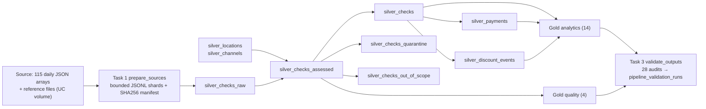

# Sun Holdings × Applebee's: discount and tip pattern pipeline

A Databricks Lakeflow pipeline that turns 115 days of Applebee's (RMH franchisee) POS
check files into validated Silver and Gold tables. The business can then see where
discount, tip and payment patterns deserve review.

> **Business question:** How can Sun Holdings identify suspicious discount and tip
> patterns across multiple locations?
> **Principle:** an anomaly is a review candidate, not proof of fraud.

**Project status (November 19, 2026):** Phase 2 (pipeline) is complete; its evidence
below is unchanged and preserved as submitted. The final phase (dashboard, risk
indicators, audit-priority queue and recommendations, due December 7, 2026) is in
progress. The repository is **public** and contains code, documentation and
aggregate evidence only.

## Evaluator quick guide

| Rubric criterion | Where to look |
|---|---|
| GitHub repository & documentation | This README, the [repository map](#repository-map), [runbook](docs/RUNBOOK_ES.md) |
| Job & pipeline design | [Job design](#job-design-orchestration-failures-and-reruns), [job YAML](resources/jobs/daily_orchestration_job.yml), [pipeline YAML](resources/pipelines/lakeflow_pipeline.yml) |
| Transformations & table value | [Architecture](#architecture-and-data-flow), [Silver code](src/transformations/silver/mv_checks_cleaned.py), [Gold code](src/transformations/gold/mv_executive_kpis.sql), [data contract](docs/DATA_CONTRACT.md) |
| Streaming, materialized views, liquid clustering & expectations | [Engineering best practices](#engineering-best-practices) |
| Data quality checks | [Data quality](#data-quality), [quality SQL](src/transformations/gold/mv_quality_metrics.sql), [validation gate](src/transformations/gold/validate_pipeline_source.py), [audit exports](evidence/) |
| Analysis, insights & business value | [Findings](#analysis-and-business-value), [business findings](docs/BUSINESS_FINDINGS.md), [Gold export](evidence/runtime_gold_evidence.csv) |
| Technical communication | [Rubric-to-evidence checklist](docs/RUBRIC_EVIDENCE.md), [data contract](docs/DATA_CONTRACT.md) |

## Repository map

```text
sun-holdings-applebees-fraud-detection/
├── README.md                      Start here
├── databricks.yml                 Asset Bundle entry point (variables, dev target)
├── resources/
│   ├── jobs/
│   │   └── daily_orchestration_job.yml   3-task job: prepare → refresh → validate
│   └── pipelines/
│       └── lakeflow_pipeline.yml         Lakeflow pipeline: the 3 library files below
├── src/
│   ├── transformations/           Code that runs in Databricks (paths used by the live job)
│   │   ├── silver/
│   │   │   ├── prepare_checks_jsonl.ipynb     Job task 1: JSON arrays → bounded JSONL shards
│   │   │   ├── prepare_checks_jsonl_source.py Same logic as an importable module (tested locally)
│   │   │   └── mv_checks_cleaned.py           Pipeline library: 9 Silver datasets + expectations
│   │   └── gold/
│   │       ├── mv_executive_kpis.sql          Pipeline library: 14 analytical Gold datasets
│   │       ├── mv_quality_metrics.sql         Pipeline library: 4 Gold quality datasets
│   │       ├── validate_pipeline.ipynb        Job task 3: post-run publication gate (28 audits)
│   │       └── validate_pipeline_source.py    Same gate as source code
│   └── queries/                   Read-only SQL for demos, diagnostics and evidence export
├── tests/                         Local tests and independent source audit
├── docs/                          Data contract, business findings, rubric evidence, runbook
├── evidence/                      Exported runtime audits and source manifests (aggregates only)
└── archive/phase1_eda/            Week 4 EDA deliverable, kept for traceability
```

Only `src/transformations/` and `resources/` are deployed to Databricks. Everything
else supports review, reproducibility and traceability.

## Business objective

Discount misuse is hard to see in raw POS files. Each daily file is a large nested
array of checks, with items, discounts and payments at different levels. Joining
those levels naively multiplies amounts. Reading them naively exhausted memory.

The pipeline produces **trustworthy, reconciled tables** at explicit grains, so that
operations can compare locations, channels and dates and decide **where to look
first**. It deliberately reports *review signals* (concentrations, statistical
outliers, missing records) rather than fraud labels.

## Architecture and data flow



| Layer | What happens | Why it is needed |
|---|---|---|
| **Source / landing** | `prepare_sources` streams each original JSON array into ~16 MiB JSON Lines shards, adds `_source_file` lineage and writes a SHA256 manifest last | Direct reads of the large arrays exhausted Photon memory. Originals stay untouched; cached shards are reused when hashes match |
| **Silver** | Explicit schemas, `try_cast` dates, composite key `business_date + LocationId + check_id`, reference enrichment, quality reasons, quarantine, and separate payment and discount tables | `Check.Id` is unique only per day and store. Separating child arrays prevents double counting of amounts |
| **Gold** | Materialized views at explicit grains: coverage, daily/location/channel metrics, tip statistics and outliers, discount catalog, missing payments, actor activity and quality metrics | Precomputes the comparisons the business asks for, with stated denominators |
| **Validation gate** | Compares source, assessed and published counts, reconciles amounts and child counts, and checks fingerprints against the prior accepted run | The job fails visibly if outputs cannot be trusted |

### Tables and their value

| Dataset | Grain and purpose |
|---|---|
| `silver_checks_raw` | One typed source record, with original file path and corruption indicator |
| `silver_locations`, `silver_channels` | One row per reference ID; missing or duplicate reference IDs fail the update |
| `silver_checks_assessed` | Every source record, composite-key multiplicity, reference checks, scope and quality reasons |
| `silver_checks` | One valid in-scope check per business date + location + check ID (liquid clustered by date and location) |
| `silver_checks_quarantine` | Every unusable source row with all applicable reasons; all copies of duplicate keys are retained here |
| `silver_checks_out_of_scope` | Valid records outside the configured dates, kept separate from quality failures |
| `silver_payments` | One payment position within a valid check, preserving signed amount, tip and actor ID |
| `silver_discount_events` | One discount position at ticket or item level, preserving source positions and actor IDs |
| `gold_coverage`, `gold_daily_metrics`, `gold_location_metrics`, `gold_channel_metrics` | Reconciled populations and discount rates at explicit grains |
| `gold_tip_distribution`, `gold_tip_statistics`, `gold_tip_comparison` | Sign, magnitude, mean/median and comparison with observed payment data |
| `gold_discount_catalog`, `gold_discount_location_top5` | Event counts by level/category and top locations within each category |
| `gold_missing_payment_locations`, `gold_tip_outliers`, `gold_positive_tip_evidence` | Operational exception investigation, with traceability to source file |
| `gold_employee_discount_activity`, `gold_manager_discount_activity` | Private activity concentration with explicit denominators; not an employee fraud classification |
| `gold_data_quality`, `gold_quality_issues`, `gold_duplicate_keys`, `gold_missing_dates` | Completeness, validity, uniqueness and reconciliation evidence |
| `pipeline_validation_runs` | Validator audit, keyed by job run + metric, outside the pipeline-managed graph |

Formulas, null and sign handling are defined in the [data contract](docs/DATA_CONTRACT.md).

## Job design: orchestration, failures and reruns

The job `applebees-phase2-daily-dev` has three sequential tasks, each running only
if the previous one succeeded (`run_if: ALL_SUCCESS`):

| Task | Type | Retries / timeout | Purpose |
|---|---|---|---|
| `prepare_sources` | Notebook | 1 retry after 60 s / 2 h | Bounded JSONL preparation with SHA256 cache |
| `refresh_pipeline` | Lakeflow pipeline (`full_refresh: false`) | 1 retry after 60 s / 2 h | Refresh the 27 Silver and Gold datasets |
| `validate_outputs` | Notebook | No retry / 30 min | Publication gate; data failures need investigation, not retries |

- **Triggering:** concurrency is one. The observed workspace job is triggered
  manually. The YAML contains a daily 07:00 `America/Mexico_City` schedule that is
  **PAUSED** on purpose: the input is a fixed historical snapshot, so a schedule adds
  value only once a real new-data cadence is agreed.
- **Preparation** publishes its active file inventory last, so the pipeline never
  reads a half-written directory. Old cache files are excluded from the active
  inventory, preventing duplicate reads. A failed preparation blocks the pipeline task.
- **Failures:** a source parsing or reference-dimension failure prevents publication.
  Invalid checks keep their reasons in quarantine, and the validator fails while
  quarantine is nonempty, forcing an operator review.
- **Reruns:** after fixing the source or code, rerun the failed task or the whole job.
  Refreshes recompute results rather than append another copy of all checks. Serverless
  auto-optimization is disabled for the notebook tasks so the retry bounds above hold.
- **Consumers** must check the latest gate (`run_complete=true`) before using outputs.
  Per-table refresh atomicity does not make all tables publish as one transaction.
- **Repeatability:** a second run with unchanged sources compares deterministic
  fingerprints with the prior accepted run. The first run records `FIRST_RUN`.

## Data quality

| Dimension | Check | Action |
|---|---|---|
| Completeness | Source = assessed = published counts; every expected date present; missing item or discount lists | Gate fails on mismatch; missing dates reported in `gold_missing_dates` |
| Uniqueness | Composite-key multiplicity; reference ID uniqueness | Duplicates quarantined (all copies); duplicate reference IDs fail the update |
| Validity | `try_cast` dates/timestamps; numeric payment and discount fields; corrupt JSON | Quarantine with reasons |
| Consistency | Unknown location or channel; daily and location totals equal the overall total | Quarantine; gate reconciliation |
| Accuracy (internal) | Payment and tip amounts reconcile after splitting child arrays (tolerance 0.01) | Gate fails on mismatch |
| Monitored, not removed | Empty payment lists, timestamp problems | Reported separately; they are operational signals, not invalid records |

Expectations: **warn** expectations keep records and record metrics; **fail**
expectations protect dimension uniqueness and the validity of published checks.
No silent deduplication or arbitrary first-row survivor is used. Check IDs such as
**-1 are preserved** because they occur in the supplied data. Negative gratuity is the
dataset's standard sign convention and is not treated as an anomaly.

**Results (both complete job runs):** 0 duplicate keys, 0 corrupt records, 0
quarantined rows, 0 missing dates, 28/28 audits passed; payment and tip
reconciliation differences of 6.63e-06 and 3.65e-07. See the
[job 1](evidence/runtime_job_1_validation.csv) and [job 2](evidence/runtime_job_2_validation.csv) audits.

## Engineering best practices

| Feature | Decision and reason | Where |
|---|---|---|
| Streaming (evaluated) | Not used in Phase 2: the input is a fixed historical snapshot, so batch materialized views over prepared shards are simpler and fully reproducible. Auto Loader/streaming tables need an append-only landing contract and checkpoints; this is the planned path for incremental ingestion | [pipeline YAML](resources/pipelines/lakeflow_pipeline.yml) (`continuous: false`) |
| Materialized views | All Silver and Gold datasets are managed, refreshable materialized views; Gold precomputes repeated reporting aggregations | [Silver](src/transformations/silver/mv_checks_cleaned.py), [Gold](src/transformations/gold/mv_executive_kpis.sql) |
| Liquid clustering | `silver_checks` is clustered by `business_date` and `LocationId`, matching the date and location filters downstream; no manual partitions | `cluster_by` in [mv_checks_cleaned.py](src/transformations/silver/mv_checks_cleaned.py) |
| Expectations | `expect`, `expect_all` (warn) and `expect_or_fail` (fail), plus a quarantine table for inspectable evidence | [mv_checks_cleaned.py](src/transformations/silver/mv_checks_cleaned.py) |
| Repeatability | Fixed interval and source manifest, distinct actor/event grains, validator fingerprints and an audit `MERGE` by run ID | [validation gate](src/transformations/gold/validate_pipeline_source.py) |
| Incrementality | `full_refresh: false` plus the SHA256 preparation cache avoid redundant work, but this is not end-to-end incremental ingestion | [job YAML](resources/jobs/daily_orchestration_job.yml) |
| Infrastructure as code | Job and pipeline declared in a Databricks Asset Bundle with variables for catalog, schema, source and dates | [databricks.yml](databricks.yml) |
| Data privacy | Original JSON, source ZIP, employee dimensions and individual evidence stay out of GitHub; `.gitignore` blocks data folders and private files | [.gitignore](.gitignore) |

Clustering is configured in code; no measured speed or cost gain is claimed.

## Analysis and business value

Verified on the accepted Gold population (2,142,846 checks, 127 locations, 115 days,
April 28 – August 20, 2026):

| Observation | Evidence-based interpretation | Next action |
|---|---|---|
| 268,590 checks with discounts, 12.5343% overall | Global weighted rate differs from mean daily rate (12.6161%) and mean location rate (12.5964%) | Compare like-for-like rates and volumes |
| 3,856 empty payment lists, 0.1800% of checks | Missing payment records require reconciliation; they do not establish an unpaid bill | Review source-system lifecycle |
| Locations 87, 1 and 141 account for 71.08% of empty-payment cases | Concentration shows where investigation may have the highest yield. Case shares are 34.62%, 24.07% and 12.40%; local empty-payment rates are 4.56%, 3.42% and 3.61%, against 0.18% overall | Review these checks at the three locations first |
| 77,856 checks above the IQR tip threshold of 17.5 (Q1 = 0, Q3 = 7, available-tip population) | Statistical outliers; many zero tips lower the threshold, and a large tip may fit a large bill | Compare tips with check amount before drawing conclusions |
| Three checks have positive aggregate tip values | Sign convention exceptions deserve targeted review | Use date + location + check ID + payment actor and source file in private evidence |
| Ticket/item discount events: 240,699 / 275,991 | Event counts are different from unique discounted checks | Keep levels separate and validate monetary overlap before summing |

See [business findings](docs/BUSINESS_FINDINGS.md) for denominators, limitations and
recommendations. No model accuracy, reduction in losses or detected-fraud count is claimed.

## Verified execution (October 29, 2026)

| Runtime observation | Verified result |
|---|---|
| Job / complete runs | `54448068766203` / `469997930036472` and `904398544867578` |
| Observed job durations | 19 min 34 s and 21 min 23 s |
| Source = assessed = published checks | 2,142,846 each, from 115 original files |
| Quarantined, out-of-scope, corrupt checks and missing dates | 0 |
| Audit results | 28/28 passed in both runs, plus the prior manual run |
| Discounted checks | 268,590 |
| Ticket / item discount events | 240,699 / 275,991 |
| Payment events | 2,232,092 |
| Empty payment lists retained | 3,856 |
| Fingerprints | Source and published-check fingerprints match across both runs and the manual run |

Evidence: [runtime_evidence.json](evidence/runtime_evidence.json),
[job 1 audit](evidence/runtime_job_1_validation.csv),
[job 2 audit](evidence/runtime_job_2_validation.csv),
[manual audit](evidence/runtime_manual_validation.csv) and
[Gold export](evidence/runtime_gold_evidence.csv). These exports contain no individual
check or employee records. Folder guide: [evidence/README.md](evidence/README.md).

## How to run

1. Upload the dataset to the Unity Catalog volume
   `/Volumes/workspace/applebees_raw/source/applebees_source` (keep `dimensions/` and `facts/`).
2. Create a Databricks Git folder from this repository and follow the
   [step-by-step runbook (Spanish)](docs/RUNBOOK_ES.md), or deploy with the CLI:
   `databricks bundle validate -t dev` then `databricks bundle deploy -t dev`.
3. Run the job `applebees-phase2-daily-dev`. Inspect results with
   [demo queries](src/queries/demo_queries.sql) and [diagnostics](src/queries/diagnose_pipeline.sql).

Local checks (no Spark needed):

```bash
python -B tests/test_pipeline_contracts.py   # structure, YAML, notebooks, links, fixtures
python -B tests/test_jsonl_preparation.py    # lossless, bounded JSONL conversion
python tests/verify_sources.py PATH_TO_DATASET   # independent source audit
```

## Limitations and scope

- Business semantics of `EmployeeId`, `ManagerId`, discount codes and tip currency are
  not confirmed by Sun Holdings; actor IDs are treated as "actor recorded on the event".
- The pipeline does not label fraud and has no machine-learning model.
- Observability such as per-task timings, pipeline update IDs and clustering query
  profiles was not captured. No performance, cost or accounting-accuracy gain is claimed.

**Runtime history.** The first attempt exhausted Photon memory while scanning large
JSON arrays; bounded JSONL preparation resolved it. A later update left an empty
assessed table; the SQL diagnostic detected the gap and a full refresh restored all
2,142,846 records (the cause of that intermediate state is not established). Both
complete jobs and the unchanged-source comparison then passed.

**Databricks Git folder compatibility.** The importable notebook `validate_pipeline.ipynb`
and its source `validate_pipeline_source.py` have distinct base names because
Databricks cannot store both with the same name in one folder. Text files use LF line
endings, enforced by `.gitattributes` and checked by a repository test.

## Official technical references

- [Databricks materialized views in pipelines](https://docs.databricks.com/aws/en/ldp/developer/ldp-sql-ref-create-materialized-view)
- [Expectations and actions](https://docs.databricks.com/aws/en/ldp/expectations)
- [Quarantine patterns](https://docs.databricks.com/aws/en/ldp/expectation-patterns)
- [Job and serverless bundle examples](https://docs.databricks.com/aws/en/dev-tools/bundles/examples)
- [JSON Lines and multiline JSON reading](https://docs.databricks.com/aws/en/query/formats/json)
