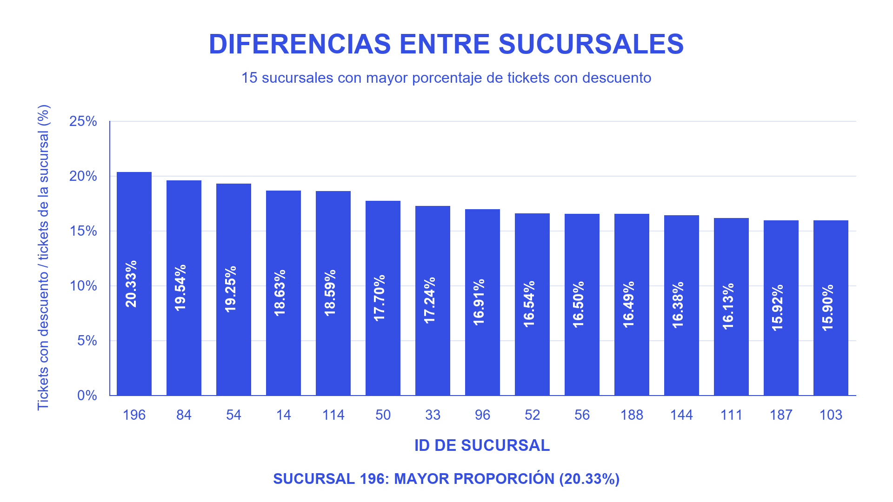
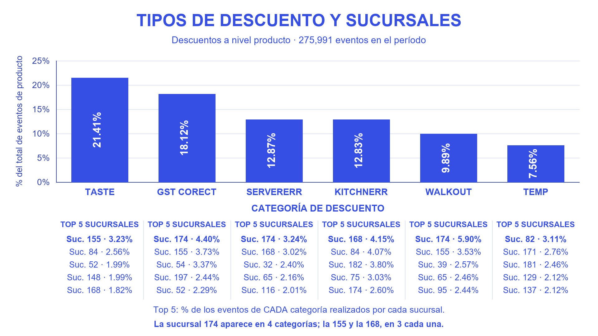
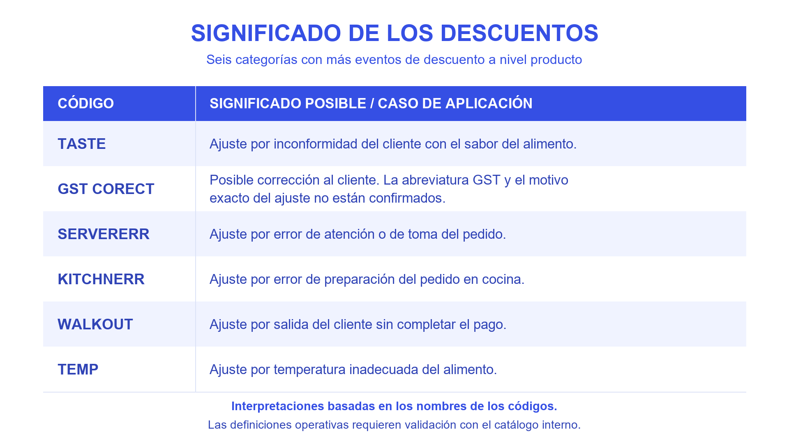

> Historical Week 4 document. Current Phase 2 instructions and execution status are in the root README.

# Materiales de presentación — Week 4

Los tres archivos siguientes son imágenes de las diapositivas preparadas para Canva, no un export completo de la presentación ni gráficas editables dentro de GitHub.

## Diapositiva 9: diferencias por sucursal

## Diapositiva 10: tipos y top 5 de sucursales

## Diapositiva 11: significados posibles

Los significados son hipótesis por nombre. Las autorizaciones y definiciones operativas requieren catálogo interno. El material completo editable se mantiene en Canva y la evidencia técnica en Databricks.
